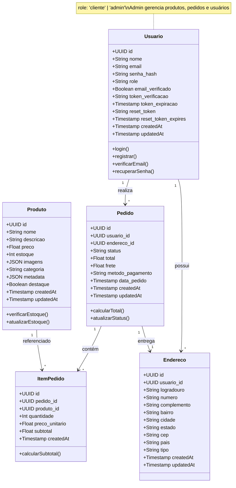

# 📡 Roberson Store - API

Backend do e-commerce de consoles e jogos, desenvolvido como projeto de TCC e portfólio full-stack.

> **Nota:** o projeto foi originalmente desenvolvido para um cliente sob o nome "Colecionateca". Após o cliente desistir do projeto, ele foi adaptado como portfólio pessoal e trabalho de conclusão de curso.

---

## 🚀 Tecnologias

- Node.js 24
- Express 5
- TypeScript
- Drizzle ORM
- PostgreSQL (Neon)

**Integrações:** Mercado Pago (Checkout Pro), Melhor Envio (frete), Cloudinary (imagens), Resend (e-mail).

---

## 📊 Diagrama de Classes



---

## 🛠️ Como rodar localmente

```bash
# 1. Instalar dependências
npm install

# 2. Configurar variáveis de ambiente
cp .env.example .env

# 3. Rodar migrations
npm run db:generate
npm run db:migrate

# 4. Iniciar servidor
npm run dev
```

---

## 🔐 Variáveis de Ambiente

| Variável | Descrição |
|----------|-----------|
| `DATABASE_URL` | Conexão com PostgreSQL |
| `JWT_SECRET` | Chave para tokens JWT |
| `RESEND_API_KEY` | API Key do Resend (e-mails) |
| `MERCADO_PAGO_ACCESS_TOKEN` | Token do Mercado Pago (sandbox) |
| `MERCADO_PAGO_PUBLIC_KEY` | Public Key do Mercado Pago |
| `MELHOR_ENVIO_TOKEN` | Token do Melhor Envio (sandbox) |
| `CLOUDINARY_*` | Credenciais do Cloudinary |
| `EMAIL_LOJISTA` | E-mail que recebe notificações de pedido |

---

## 📡 Endpoints principais

| Método | Rota | Descrição |
|--------|------|-----------|
| `POST` | `/auth/register` | Cadastro de usuário |
| `POST` | `/auth/login` | Login (retorna token) |
| `GET` | `/produtos` | Listar produtos |
| `GET` | `/produtos/destaque` | Produtos em destaque |
| `POST` | `/checkout/pagar` | Criar pagamento no Mercado Pago |
| `POST` | `/frete/calcular` | Calcular frete |
| `GET` | `/health` | Health check |

---

## 🧭 Decisões Técnicas

- **Drizzle ORM em vez de Prisma:** tipagem mais próxima do SQL e menor overhead em runtime.
- **Checkout Pro do Mercado Pago:** reduz a complexidade de PCI compliance, delegando a captura de dados do cartão ao ambiente seguro do Mercado Pago.
- **Melhor Envio para frete:** integração com múltiplas transportadoras em uma única API.
- **Webhook de pagamento não implementado:** decisão consciente de escopo, por ser um projeto de demonstração sem entrega real de produtos. O fluxo de pagamento é funcional até a confirmação no Mercado Pago.
- **RBAC com campo `role`:** não existe tabela separada de admin; o administrador é um `Usuario` com `role = 'admin'`, o que simplifica a modelagem.

---

## 🌐 Deploy

Render: [https://colecionateca-api.onrender.com](https://colecionateca-api.onrender.com)

---

## 👤 Autor

**Roberson Junior** — Desenvolvedor Full-Stack
- GitHub: [@JRoberson23](https://github.com/JRoberson23)
- YouTube: [@RobersonDev](https://www.youtube.com/@RobersonDev)