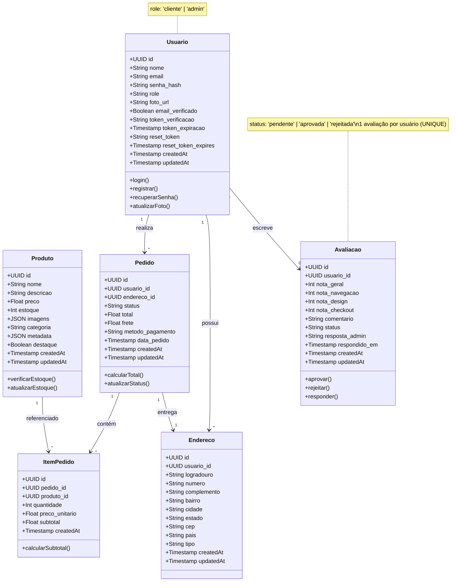

# 📡 Roberson Store - API

Backend do e-commerce de consoles e jogos, desenvolvido como projeto de TCC e portfólio full-stack.

> **Nota:** o projeto foi originalmente desenvolvido para um cliente sob o nome "Colecionateca". Após o cliente desistir do projeto, ele foi adaptado como portfólio pessoal e trabalho de conclusão de curso.

---

## 🚀 Tecnologias

- Node.js 24
- Express 5
- TypeScript
- Drizzle ORM
- PostgreSQL (Neon)
- JWT (autenticação)
- Bcrypt (hash de senhas)
- Zod (validação)

**Integrações externas:**
- Mercado Pago (Checkout Pro)
- Melhor Envio (frete)
- Cloudinary (imagens de produtos e avatares)
- Brevo (envio de e-mails transacionais)

---

## 📊 Diagrama de Classes



---

## 🧭 Decisões Técnicas

- **Drizzle ORM em vez de Prisma:** tipagem mais próxima do SQL e menor overhead em runtime.
- **Checkout Pro do Mercado Pago:** reduz a complexidade de PCI compliance, delegando a captura de dados do cartão ao ambiente seguro do Mercado Pago.
- **Melhor Envio para frete:** integração com múltiplas transportadoras em uma única API.
- **Webhook de pagamento não implementado:** decisão consciente de escopo — por ser um projeto de demonstração sem entrega real de produtos, o fluxo de pagamento é funcional até a confirmação no Mercado Pago.
- **RBAC com campo `role`:** não existe tabela separada de admin; o administrador é um `Usuario` com `role = 'admin'`, o que simplifica a modelagem.
- **Sistema de avaliações com moderação:** avaliações passam por aprovação do admin antes de serem publicadas. A constraint `UNIQUE` em `usuario_id` garante uma avaliação por usuário, mas permite edição (que volta ao status `pendente`).
- **Avatar com fallback de iniciais:** quando o usuário não tem foto, o frontend gera iniciais coloridas de forma determinística. A foto é armazenada no Cloudinary com resize automático para 400x400.
- **Brevo em vez de Resend:** o Resend limita o envio para o próprio e-mail verificado na conta gratuita. A Brevo permite envio para qualquer destinatário no plano gratuito (300 e-mails/dia).
- **Recuperação de senha com token temporário:** token UUID com validade de 1 hora, armazenado na tabela `usuarios` (`reset_token` e `reset_token_expires`).

---

## 🛠️ Como rodar localmente

```bash
# 1. Instalar dependências
npm install

# 2. Configurar variáveis de ambiente
cp .env.example .env

# 3. Rodar migrations
npm run db:generate
npm run db:migrate

# 4. Iniciar servidor
npm run dev
```

---

## 🔐 Variáveis de Ambiente

| Variável | Descrição |
|----------|-----------|
| `DATABASE_URL` | Conexão com PostgreSQL |
| `JWT_SECRET` | Chave para tokens JWT |
| `BREVO_API_KEY` | Chave da API Brevo (e-mails) |
| `MERCADO_PAGO_ACCESS_TOKEN` | Token do Mercado Pago (sandbox) |
| `MERCADO_PAGO_PUBLIC_KEY` | Public Key do Mercado Pago |
| `MELHOR_ENVIO_TOKEN` | Token do Melhor Envio (sandbox) |
| `CLOUDINARY_*` | Credenciais do Cloudinary |
| `EMAIL_LOJISTA` | E-mail que recebe notificações de pedido |
| `APP_URL` | URL do frontend (usada nos links de e-mail) |
| `API_URL` | URL pública da API |

---

## 📡 Endpoints principais

### Autenticação
| Método | Rota | Descrição |
|--------|------|-----------|
| `POST` | `/auth/register` | Cadastro de usuário |
| `POST` | `/auth/login` | Login (retorna token + dados + `foto_url`) |
| `POST` | `/auth/forgot-password` | Solicitar recuperação de senha |
| `POST` | `/auth/reset-password` | Redefinir senha com token |
| `PUT` | `/auth/perfil` | Atualizar nome, e-mail e senha |
| `PUT` | `/auth/foto` | Upload de foto de perfil |
| `DELETE` | `/auth/foto` | Remover foto de perfil |

### Produtos
| Método | Rota | Descrição |
|--------|------|-----------|
| `GET` | `/produtos` | Listar produtos (filtro por categoria) |
| `GET` | `/produtos/destaque` | Produtos em destaque |
| `GET` | `/produtos/:id` | Buscar produto por ID |
| `POST` | `/produtos` | Criar produto (admin) |
| `PUT` | `/produtos/:id` | Atualizar produto (admin) |
| `DELETE` | `/produtos/:id` | Remover produto (admin) |

### Avaliações
| Método | Rota | Descrição |
|--------|------|-----------|
| `GET` | `/avaliacoes` | Listar aprovadas (público) + média + filtro |
| `GET` | `/avaliacoes/minha` | Buscar avaliação do usuário logado |
| `POST` | `/avaliacoes` | Criar/editar avaliação |
| `DELETE` | `/avaliacoes/minha` | Excluir a própria avaliação |
| `GET` | `/avaliacoes/admin/todas` | Listar todas (admin) |
| `PATCH` | `/avaliacoes/admin/:id/aprovar` | Aprovar (admin) |
| `PATCH` | `/avaliacoes/admin/:id/rejeitar` | Rejeitar (admin) |
| `PATCH` | `/avaliacoes/admin/:id/responder` | Responder (admin) |
| `DELETE` | `/avaliacoes/admin/:id` | Excluir qualquer (admin) |

### Checkout e Frete
| Método | Rota | Descrição |
|--------|------|-----------|
| `POST` | `/checkout/pagar` | Criar preferência no Mercado Pago |
| `POST` | `/checkout` | Finalizar pedido |
| `POST` | `/frete/calcular` | Calcular frete |

### Health
| Método | Rota | Descrição |
|--------|------|-----------|
| `GET` | `/health` | Health check |

---

## 🌐 Deploy

- **API:** [https://colecionateca-api.onrender.com](https://colecionateca-api.onrender.com) (Render)
- **Banco:** Neon PostgreSQL

---

## 👤 Autor

**Roberson Junior** — Desenvolvedor Full-Stack
- GitHub: [@JRoberson23](https://github.com/JRoberson23)
- YouTube: [@RobersonDev](https://www.youtube.com/@RobersonDev)
- Instagram: [@roberson.tech](https://www.instagram.com/roberson.tech/)

---

## 📄 Licença

Projeto de portfólio e trabalho de conclusão de curso. Código disponível para fins educacionais.